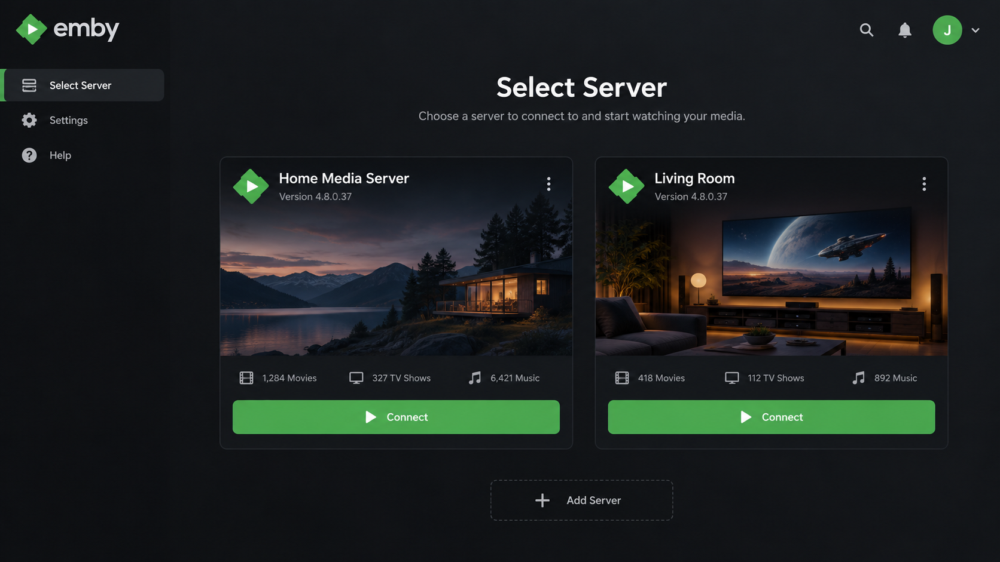
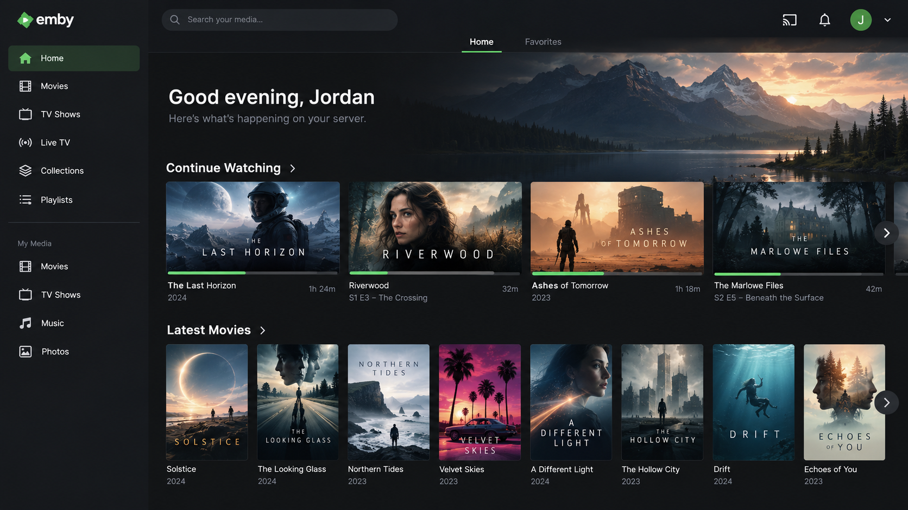
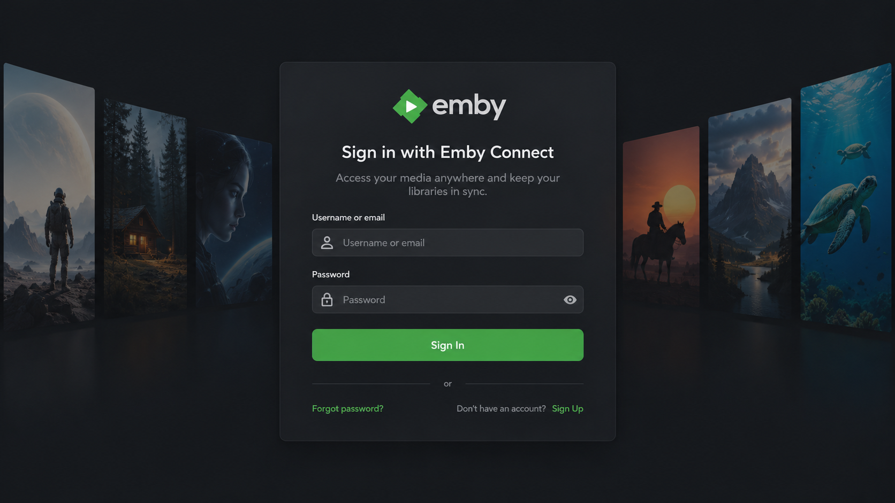

# Emby Server - Personal Media Streaming For Every Screen

Emby Connect presents Emby Server, a personal media server for organizing and streaming videos, music, photos, and live TV. Emby Server uses a client-server model, supports adaptive transcoding, and exposes a REST-based API for compatible clients.

[](https://emby-connect.github.io/emby-server/emby-server)

## Emby Apps

Emby Server works with clients for televisions, phones, tablets, browsers, and streaming devices.

- Android and Android TV
- Amazon Fire TV and Emby Firestick
- Apple TV, iPhone, and iPad
- Chromecast
- Roku
- Samsung Tizen and LG WebOS
- Nvidia Shield
- Desktop and browser clients



### How do I get Emby on my TV?

Install the appropriate Emby client for your television or connected streaming device. Emby Apple TV, Emby Roku, Emby Fire TV, Emby Chromecast, Emby Samsung, Emby Tizen, and Emby WebOS clients connect to the Emby Server address configured during setup.

Confirm that the television and Emby Server are on the same network for the first connection. Open the client, enter the local server address when discovery does not find it automatically, and sign in with the user created during Emby Server setup. Remote playback additionally requires a working Emby remote access setup.

## New Users

The normal Emby Server setup flow is:

1. Choose an Emby Linux, Emby Server Windows, or supported NAS host.
2. Add folders containing movies, television programs, music, and photos.
3. Create users and configure library access.
4. Confirm direct playback and Emby hardware transcoding behavior.
5. Configure secure remote access only after local playback works.

The Emby folder structure should separate media types and use consistent names. This improves metadata matching and makes it easier to understand how to add movies to Emby Server without mixing films, series, and personal recordings.

## Developer Info

This repository contains a compact .NET server selection under Emby Connect. The retained solution is [Jellyfin.sln](Jellyfin.sln), reflecting the upstream lineage of the selected server files.

Important entry points include:

- [Program.cs](src/Program.cs) for process startup.
- [Startup.cs](src/Startup.cs) for server initialization.
- [ApplicationHost.cs](src/ApplicationHost.cs) for application hosting.
- [ApiApplicationBuilderExtensions.cs](src/ApiApplicationBuilderExtensions.cs) for API registration.
- [ServiceCollectionExtensions.cs](src/ServiceCollectionExtensions.cs) for dependency registration.
- [ItemsController.cs](src/ItemsController.cs), [VideosController.cs](src/VideosController.cs), and [AudioController.cs](src/AudioController.cs) for media APIs.
- [AuthenticationManager.cs](src/AuthenticationManager.cs) and [AuthorizationContext.cs](src/AuthorizationContext.cs) for access control.

## Visit Our Community

Use the Emby community for product support, client compatibility questions, and Emby Premiere account assistance. Repository issues should focus on the selected code, build configuration, and reproducible server behavior.

## Images



## Find Your Setup

emby server, emby server ubuntu, emby server hosting, secure emby server, how to add movies to emby server, media-server, self-hosted, media-streaming, home-media, transcoding, docker, live-tv

## Supported Architectures

The Docker configuration is intended for common 64-bit server hosts.

| Architecture | Available | Notes |
| :---: | :---: | --- |
| x86-64 | Yes | Suitable for Intel and AMD home servers. |
| arm64 | Yes | Suitable for supported ARM systems and capable NAS devices. |

An Emby Raspberry Pi installation requires enough memory and appropriate video devices for its workload. Emby 4K and Emby AV1 transcoding can require substantially more processing power than direct playback.

## Version Tags

| Tag | Intended Use | Description |
| :---: | --- | --- |
| Stable | Normal use | Intended for established Emby Server releases. |
| Beta | Evaluation | Intended for testing newer behavior before production use. |

## Application Setup

The default Emby Server port is `8096` for HTTP. Port `8920` can be used for HTTPS after configuring an appropriate certificate.

Open the web interface at:

```text
http://SERVER_ADDRESS:8096
```

Create libraries for movies, television, Emby music, photos, and recordings. Keep configuration data separate from media files so that server upgrades and container recreation do not remove the library database.

### Why can't I connect to the Emby server?

First confirm that the Emby Server process or container is running and listening on port `8096`. Verify that the Emby Server address uses the correct host IP, protocol, and port. A browser on the server itself can test the local endpoint before firewalls, reverse proxies, or remote networking are introduced.

For an Emby Docker deployment, confirm that the port is published and that the container logs do not report configuration or permission errors. Check that mounted configuration directories are writable by the configured user and group. For Emby remote access, verify router forwarding, firewall rules, TLS settings, and any Emby Nginx, Emby Cloudflare, or Emby Tailscale setup independently.

Do not expose an unsecured administrative interface directly to the internet. A secure Emby Server should use strong credentials, Emby 2FA where available, encrypted transport, current software, and narrowly scoped network access.

### Hardware Acceleration

Emby hardware transcoding requires a compatible GPU, host driver, container runtime, and Emby Premiere entitlement where applicable.

For Intel or AMD acceleration on Linux, expose the Direct Rendering Infrastructure device:

```yaml
devices:
  - /dev/dri:/dev/dri
```

For Nvidia acceleration, configure the Nvidia container runtime and expose the required GPU. Emby transcoding settings should then be validated with real media while monitoring whether playback is direct, remuxed, or transcoded.

The related implementation is represented by [MediaEncoder.cs](src/MediaEncoder.cs), [EncodingManager.cs](src/EncodingManager.cs), [EncodingHelper.cs](src/EncodingHelper.cs), [TranscodeManager.cs](src/TranscodeManager.cs), and [TranscodingJob.cs](src/TranscodingJob.cs).

## Usage

The retained [docker-compose.yml](docker-compose.yml) and [Dockerfile](Dockerfile) provide the repository-level container entry points.

```yaml
services:
  emby:
    build: .
    container_name: emby-server
    environment:
      PUID: 1000
      PGID: 1000
      TZ: Etc/UTC
    volumes:
      - ./config:/config
      - ./media/movies:/data/movies
      - ./media/tv:/data/tv
      - ./media/music:/data/music
    ports:
      - "8096:8096"
      - "8920:8920"
    devices:
      - /dev/dri:/dev/dri
    restart: unless-stopped
```

Start the Emby Docker Compose deployment with:

```bash
docker compose up -d
```

## Parameters

| Parameter | Function |
| :--- | --- |
| `8096:8096` | Publishes the HTTP web interface. |
| `8920:8920` | Publishes the optional HTTPS interface. |
| `PUID` | Selects the host user identifier. |
| `PGID` | Selects the host group identifier. |
| `TZ` | Selects the server timezone. |
| `/config` | Stores configuration, metadata, and database files. |
| `/data/movies` | Provides movie media. |
| `/data/tv` | Provides television media. |
| `/data/music` | Provides music media. |
| `/dev/dri` | Provides supported Intel or AMD video acceleration. |

### Environment Variables From Files

Sensitive environment values can be mounted from files rather than written directly into the compose configuration. Keep secrets outside version control and restrict their filesystem permissions.

### Umask For Running Applications

A custom umask controls the permissions created inside mounted directories. Confirm that the selected value allows Emby Server to read media while limiting unnecessary write access.

### User / Group Identifiers

Mounted directories must be accessible to the configured user and group. On Linux, inspect the required identifiers with:

```bash
id
```

Use matching `PUID` and `PGID` values in the Emby Docker configuration to avoid permission failures during scanning, metadata updates, and playback.

## Optional Parameters

Emby DLNA and local client discovery can require additional network access. Host networking may simplify discovery, while bridge networking offers stronger isolation and requires explicit port publication.

Emby IPTV, Emby M3U, Emby IPTV guide, and Emby HDHomeRun configurations depend on valid tuner or playlist sources. The retained live television implementation includes [LiveTvManager.cs](src/LiveTvManager.cs), [LiveTvController.cs](src/LiveTvController.cs), and [M3UTunerHost.cs](src/M3UTunerHost.cs).

## Support Info

Inspect a running container with:

```bash
docker compose ps
docker compose logs -f
docker compose exec emby sh
```

Review media probing, permissions, network bindings, and transcoding decisions before changing multiple settings at once.

## Updating Info

Preserve the configuration directory before rebuilding the container. Rebuild and recreate the local deployment with:

```bash
docker compose build --no-cache
docker compose up -d
```

Persistent configuration and media mounts should remain outside the disposable container layer.

## Building Locally

The selected repository uses .NET projects and shared build configuration from [Directory.Build.props](Directory.Build.props) and [Directory.Packages.props](Directory.Packages.props).

```bash
dotnet restore Jellyfin.sln
dotnet build Jellyfin.sln
```

The web client is not included in the selected files. The server project is [Jellyfin.Server.csproj](src/Jellyfin.Server.csproj), while API, data, drawing, networking, live TV, controller, provider, and media encoding projects are retained under `src`.

## Installation Via Helm

The selected files do not include a Helm chart, `Chart.yaml`, or Kubernetes manifest templates. An Emby Kubernetes deployment must therefore build from the retained [Dockerfile](Dockerfile) and provide its own workload, service, persistent storage, security context, and optional GPU resources.

An Emby Proxmox host can run the same container inside a suitable virtual machine or Linux container. Emby NAS deployments, including Emby Synology and Emby QNAP systems, should use persistent local storage that supports reliable file locking. When choosing the best NAS for Emby, consider CPU codec support, memory, storage throughput, and hardware transcoding access.

## Installation

### How to install Emby server on Ubuntu?

Install a compatible .NET SDK and FFmpeg, then prepare the repository build from the selected solution. Restore and build the code with:

```bash
dotnet restore Jellyfin.sln
dotnet build Jellyfin.sln
dotnet run --project src/Jellyfin.Server.csproj
```

Confirm the active framework expected by the project files before building. After startup, test the local Emby Server address on port `8096`. The selected repository does not contain a bundled web client, so a compatible client or separately supplied web interface may be required.

For an isolated Emby Server Ubuntu deployment, use the retained Docker configuration instead. Persist `/config`, mount media read-only where practical, publish only required ports, and verify host firewall rules.

## Docker Templates

For an unRAID deployment, create a container from the retained Docker configuration and map persistent configuration and media directories explicitly. Confirm each host path before startup because container paths do not automatically match the unRAID share layout.

## Jellyfin Fuzzing

The source material describes AFL++ and SharpFuzz workflows for related .NET server components. The selected repository does not retain fuzz scripts, so fuzzing requires a separately prepared harness. Security-sensitive parsers, subtitle handling, media probing, and network request processing are appropriate targets.

## Server Development

Install the .NET SDK required by the project and FFmpeg for media processing. Open [Jellyfin.sln](Jellyfin.sln) in a compatible .NET IDE or build it from the command line.

The Emby Connect repository separates responsibilities across the following components:

- Library scanning through [LibraryManager.cs](src/LibraryManager.cs) and [LibraryMonitor.cs](src/LibraryMonitor.cs).
- Metadata through [MetadataService.cs](src/MetadataService.cs), [ProviderManager.cs](src/ProviderManager.cs), and retained movie providers.
- Streaming through [StreamingHelpers.cs](src/StreamingHelpers.cs), [DynamicHlsController.cs](src/DynamicHlsController.cs), and [HlsSegmentController.cs](src/HlsSegmentController.cs).
- Images through [ImageProcessor.cs](src/ImageProcessor.cs) and [SkiaEncoder.cs](src/SkiaEncoder.cs).
- Sessions through [SessionManager.cs](src/SessionManager.cs) and [SessionsService.cs](src/SessionsService.cs).
- Subtitles through [SubtitleManager.cs](src/SubtitleManager.cs) and [SubtitleEncoder.cs](src/SubtitleEncoder.cs).



### Running The Tests

Run the retained test projects with:

```bash
dotnet test Jellyfin.sln
```

The selected tests cover HLS, encoding, image processing, library scans, tuner handling, media source selection, movie and episode resolution, sessions, subtitles, transcoding, and users.

## How To Run EFCore Migrations

The source architecture supports provider-specific database migrations, with SQLite as the default provider in the related server design. No migration source files were retained in this 100-file selection, so do not generate or apply migrations until the required database project and migration history are restored.

A migration must be created for every supported provider, reviewed for provider-specific behavior, and tested against a disposable database before use.

## OpenAPI Specification

The source material describes an exploded OpenAPI specification bundled into a single document and validated before documentation generation. This selected Emby Server repository does not include `root.yaml`, schema files, or a generated OpenAPI document.

API behavior can still be traced through the retained controllers and DTOs, including [PlaybackInfoDto.cs](src/PlaybackInfoDto.cs), [MediaSourceInfo.cs](src/MediaSourceInfo.cs), and [MediaStream.cs](src/MediaStream.cs). Generated documentation should not be published until it matches the running Emby Server implementation.

## About

Emby Server manages personal media and streams it across compatible devices. Emby Connect helps users reach their server through a linked account, while Emby Premiere enables commercial features such as supported hardware acceleration, offline syncing, Emby live TV DVR, and Emby intro skipping. Available entitlements should be verified before purchasing an Emby Premiere lifetime license or waiting for an Emby Black Friday offer.

### Features

- Personal video, Emby music, photo, and live television libraries.
- Metadata, artwork, chapters, and library scanning.
- User accounts and playback sessions.
- Direct play, remuxing, and adaptive transcoding.
- Emby 4K, Emby AV1, subtitle, and audio stream handling where supported.
- Playlists and per-user playback data.
- Emby DLNA and compatible television clients.
- Live television through compatible tuners and playlist sources.
- Docker-based self-hosting and persistent configuration.

### Which media server is better, Plex or Emby?

Neither is universally better. Emby Server offers detailed server control, broad client availability, flexible library management, and an Emby Premiere lifetime license option. Plex may be preferable for users who prioritize its ecosystem, account model, and familiar client experience.

Choose Emby when local administration, Emby Connect, client flexibility, and granular transcoding configuration fit the deployment. Choose Plex when its specific applications and service model better match the household. Test representative media, television clients, subtitles, remote playback, and hardware acceleration before committing to either platform.

## Organizing Your Media

Keep each media type in a separate directory and use predictable names. Movie folders should contain one film and its related files, while series should separate shows and seasons. Music should use consistent artist and album metadata.

Allow Emby Server to scan only intended media locations. Large libraries should place configuration and metadata on reliable local storage rather than a filesystem that lacks dependable locking.

## Reverse Proxy Set Up

An Emby Nginx or Emby Cloudflare deployment must preserve streaming responses, range requests, long-lived connections, and the original protocol information. Configure HTTPS, trusted proxy boundaries, and upload limits deliberately.

An Emby Tailscale setup can provide private remote connectivity without publishing the administration interface publicly. Test local access first, then remote access, then client playback.

## Contributing

Keep changes focused and include tests for behavior changes. Run formatting, build, and relevant test projects before submitting work. Security-sensitive changes should consider authentication, authorization, path handling, media parsing, and remote exposure.

## Database Migrations

Database migrations change stored server data and schema structure. Each migration should have a forward operation, a tested rollback where supported, deterministic ordering, detailed logging, and idempotent behavior.

The migration name should identify the target server version and describe the change. Test upgrades and downgrades against backups, and never treat a production media database as the first migration test.

## License

See [LICENSE](LICENSE) for licensing terms and [NOTICE.md](NOTICE.md) for retained notices.
